# freeCodeCamp-responsiveWebDesign-challenges
Challenges from freeCodeCamp (https://www.freecodecamp.org/).

A collection of projects I worked on while brushing up my responsive web design 
skills through the freeCodeCamp Responsive Web Design curriculum.

Enjoy my solutions and experiments!

## Technologies
This repository focuses on the foundations of responsive web design, with projects developed using:
- Semantic HTML5
- CSS3
- CSS Custom Properties (Variables)
- Flexbox
- CSS Grid
- Responsive Design (media queries, fluid sizing)
- Accessibility best practices
- Web typography

## Projects

1. **Personal Portfolio**
   

      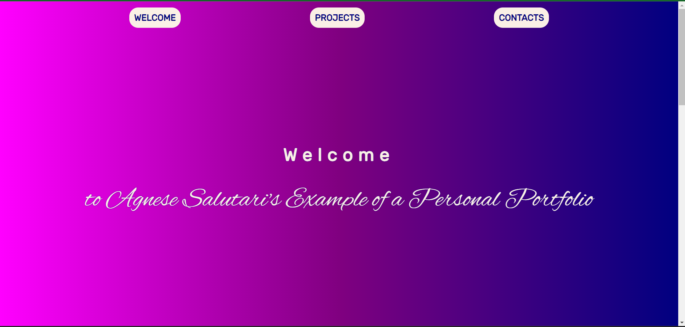
      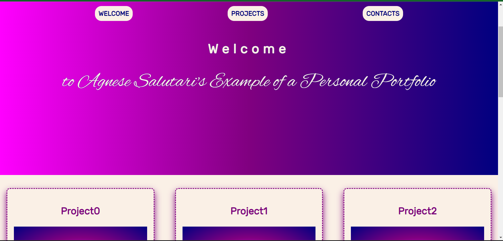
      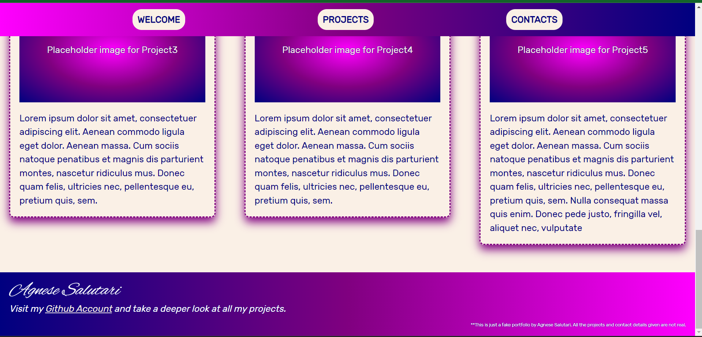
      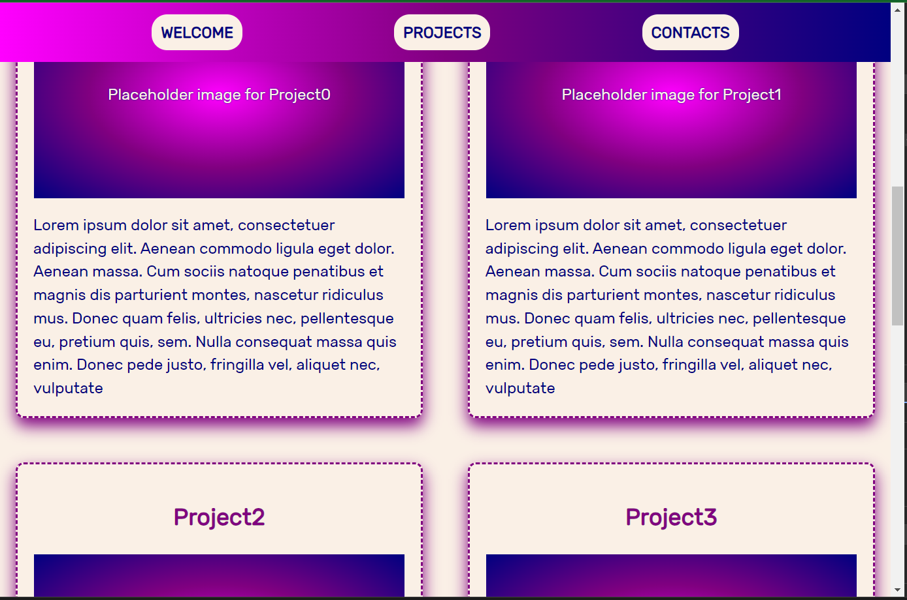
      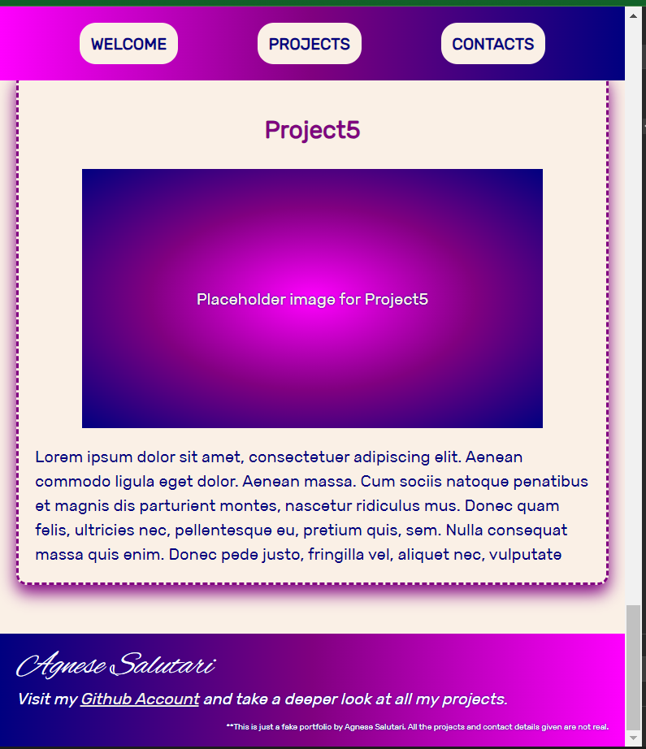
      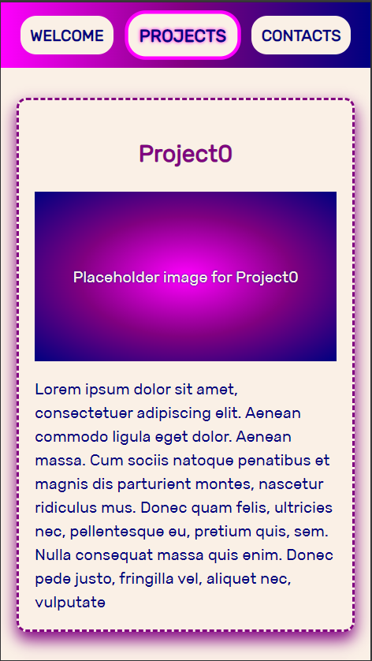
   

   [Watch the responsive design demo](docs/videos/Video0.mp4)

2. **Product Landing Page**
   

      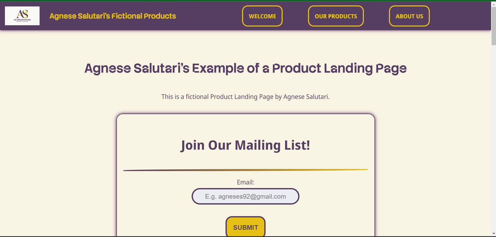
      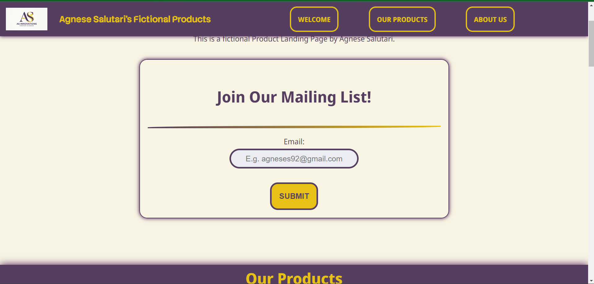
      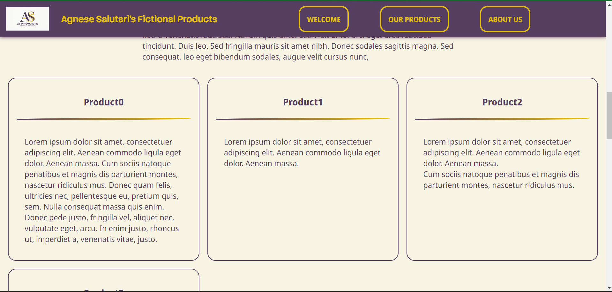
      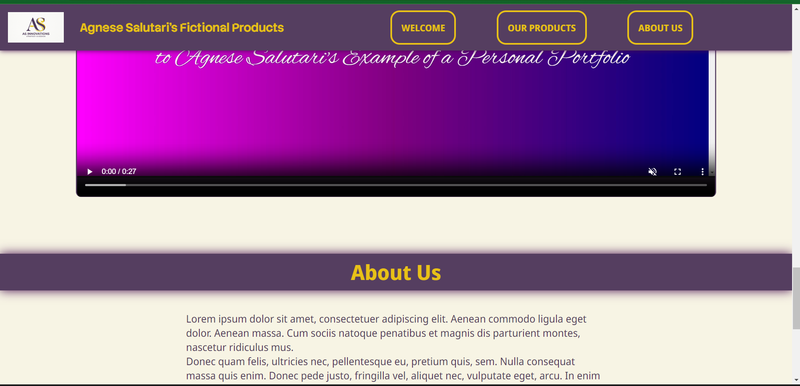
      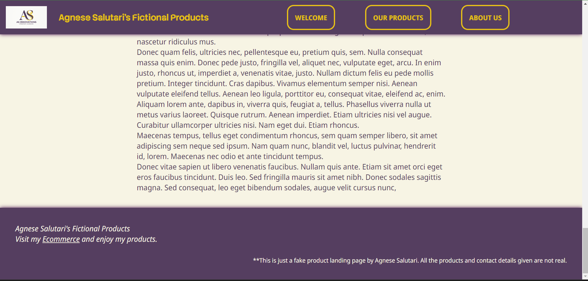
      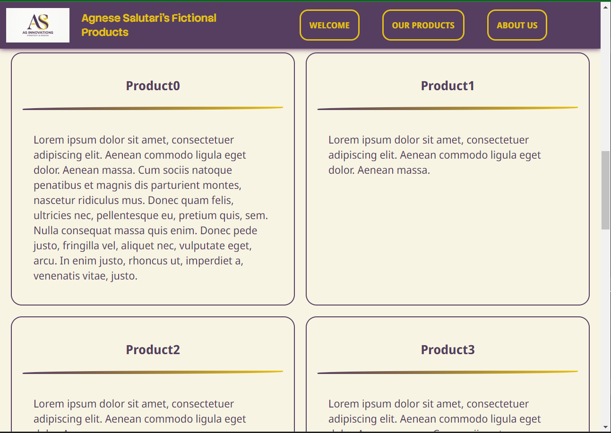
      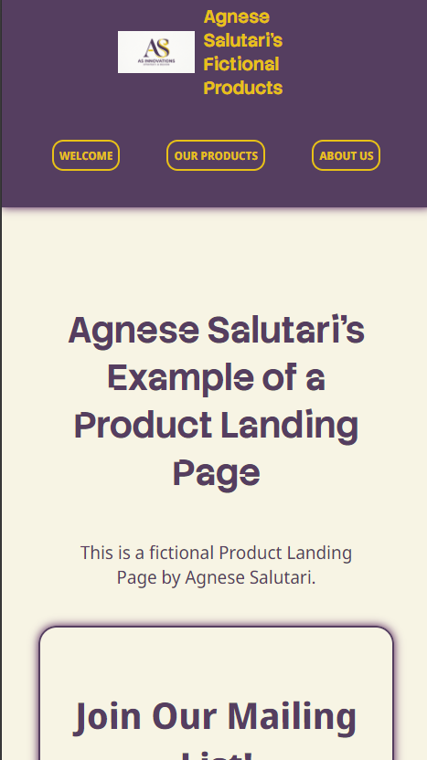
   

3. **Technical Docs Page**
   

      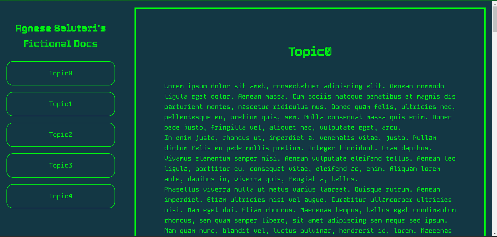
      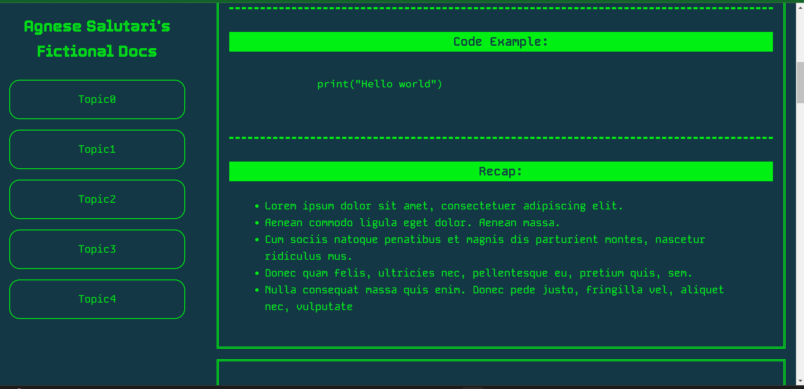
      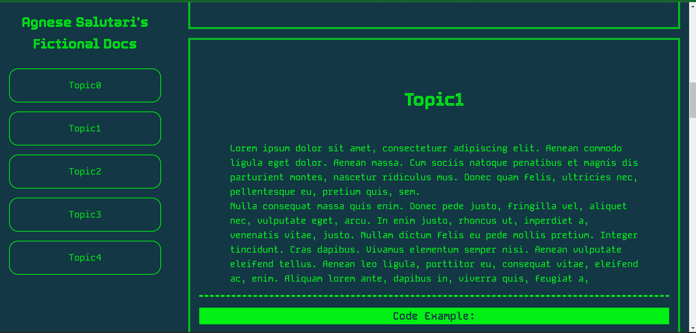
      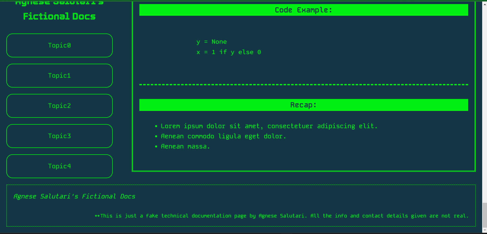
      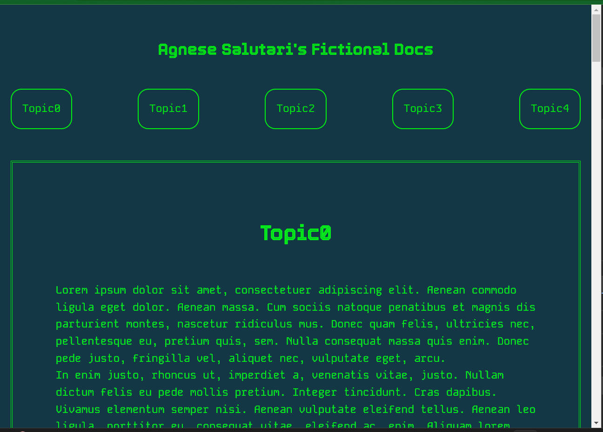
      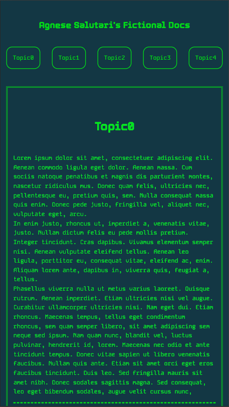
   

## Credits
This repository contains projects completed while following the freeCodeCamp Responsive Web Design curriculum.

Third-party assets (such as fonts) remain the property of their respective authors and retain their original licenses.

## Contacts

Agnese Salutari – agneses92@gmail.com

Licensed under the Apache License 2.0. See `LICENSE` for more information.

[https://github.com/agnsal](https://github.com/agnsal)

